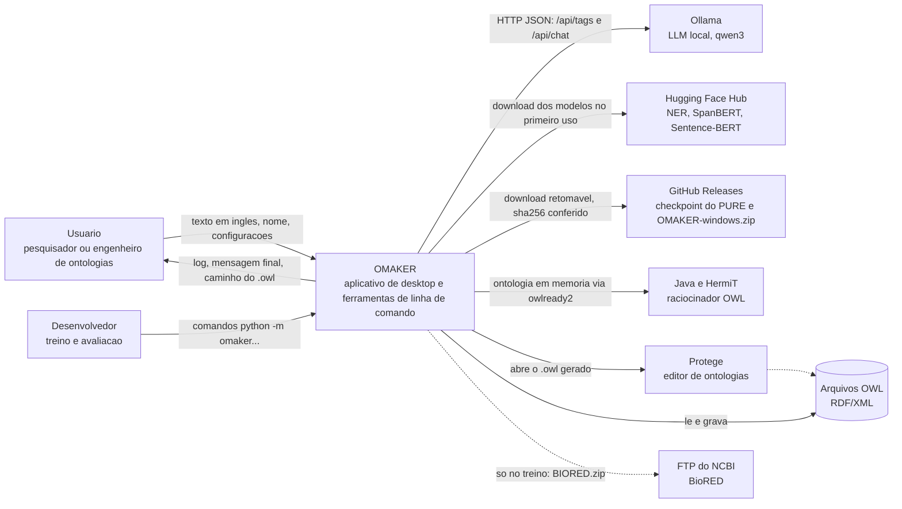

# 3. Contexto e escopo

Esta seção delimita o OMAKER: com quem ele conversa, o que entra e o que sai em cada fronteira, e o que fica de fora.

## 3.1 Diagrama de contexto

O usuário fala com o OMAKER só pela interface gráfica. O desenvolvedor usa também as ferramentas de linha de comando (treino, calibração, publicação, download e avaliação). Os serviços externos aparecem como caixas próprias porque cada um pode faltar, e o sistema tem um comportamento definido para cada falta ([seção 8](08-conceitos-transversais.md)).

## 3.2 Interfaces externas

| Parceiro | Direção | O que passa | Formato e protocolo | Código |
|---|---|---|---|---|
| Usuário (interface) | Entrada | Texto em inglês, nome do arquivo, `.owl` existente, termos para sinônimos, preferências | Widgets PySide6; diálogos de arquivo | `omaker/ui/pages/*.py` |
| Usuário (interface) | Saída | Log de cada etapa, mensagem final com o estado do raciocinador, caminho do arquivo | Sinais Qt para `QTextEdit` e `QMessageBox` | `omaker/ui/pages/runner.py`, `omaker/ui/messages.py` |
| Ollama | Ida e volta | Lista de modelos instalados; pedidos de entidades, relações e taxonomia com o esquema JSON da resposta | HTTP local: `GET /api/tags`, `POST /api/chat` com `stream: false`, `think: false`, `format` (esquema JSON), `temperature`, `num_ctx`, `num_predict` e `seed` opcional | `omaker/llm/client.py` |
| Hugging Face Hub | Entrada | Pesos e tokenizadores do NER (`d4data/biomedical-ner-all`), do SpanBERT (`SpanBERT/spanbert-base-cased`) e do Sentence-BERT (`paraphrase-multilingual-MiniLM-L12-v2`) | HTTPS, pelas bibliotecas `transformers` e `sentence-transformers` (`from_pretrained`), com o cache padrão delas | `omaker/nlp/ner.py`, `omaker/relations/model.py`, `omaker/nlp/synonyms.py` |
| GitHub Releases (modelo) | Entrada | `omaker_pure.pt` e `omaker_pure.calibration.json` da Release `pure-biored-v1` | HTTPS com cabeçalho `Range` para continuar um `.part`; sha256 conferido antes de renomear | `omaker/relations/download.py` |
| GitHub Releases (programa) | Saída do CI | `OMAKER-windows.zip` anexado à Release de uma tag `v*` | `gh release upload` no job `release` | `.github/workflows/exe.yml` |
| Java e HermiT | Ida e volta | A ontologia montada; volta consistente, inconsistente ou erro, com as inferências materializadas | owlready2 `sync_reasoner_hermit`, que chama o `java` como processo; o executável é escolhido por `find_java` | `omaker/ontology/builder.py`, `omaker/ontology/java.py` |
| Protégé | Saída | Caminho do `.owl` gerado | `subprocess.Popen([Protege.exe, caminho])`, sem shell | `omaker/ontology/protege.py` |
| Arquivos OWL | Entrada e saída | Ontologia nova; ontologia existente atualizada no mesmo arquivo; cópia com equivalências | RDF/XML (`onto.save(format="rdfxml")`); leitura por `file://` | `omaker/ontology/builder.py` |
| FTP do NCBI | Entrada (desenvolvimento) | `BIORED.zip`, do qual só os três arquivos PubTator são extraídos | HTTPS, gravado como `.part` e renomeado | `omaker/relations/biored.py` |
| Sistema de arquivos local | Entrada e saída (desenvolvimento) | `runs/<data>-<nome>/` (configuração, divisão, métricas, relatórios, checkpoints) e `data/biored/` | JSON, TOML, Markdown, arquivos do PyTorch | `omaker/relations/train.py`, `omaker/evaluation/e2e.py` |

## 3.3 Escopo

**Dentro do escopo**

- Texto biomédico em inglês, com quatro tipos de entidade no esquema (`DRUG`, `SYMPTOM`, `DISEASE`, `GENE` em `omaker/domain/labels.py`) e três relações (`treats`, `causes`, `prevents`).
- Geração de uma ontologia nova e atualização de uma existente, inclusive externa (por exemplo, a Symptom Ontology em `omaker/resources/symp.owl`).
- Agrupamento de sinônimos e gravação de equivalências numa cópia.
- Treino, calibração, publicação e avaliação do classificador de relações, pela linha de comando.

**Fora do escopo**

- Servidor, API web ou uso por vários usuários ao mesmo tempo.
- Texto em português ou outro idioma: não há tradução ([registro 0001](../decisoes/0001-pipeline-em-ingles.md)).
- Relações com genes: `GENE` existe no esquema, mas o NER não mapeia nenhum rótulo para ele (`NER_LABEL_MAP` em `omaker/nlp/ner.py`) e o LLM só propõe `DRUG`, `SYMPTOM` e `DISEASE` (`ENTITY_TYPES_LLM` em `omaker/llm/entities.py`).
- Edição manual da ontologia: isso fica com o Protégé.
- Instalar o Ollama, o modelo do LLM ou o Java: são pré-requisitos.
