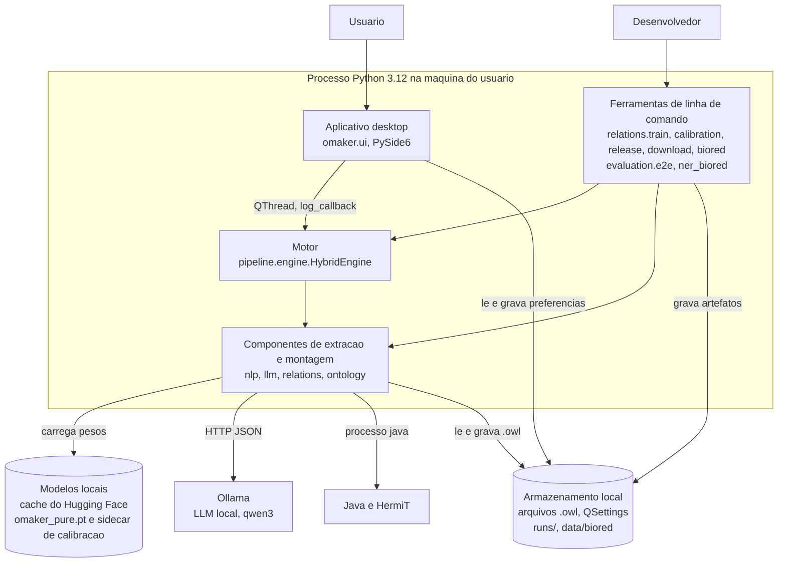
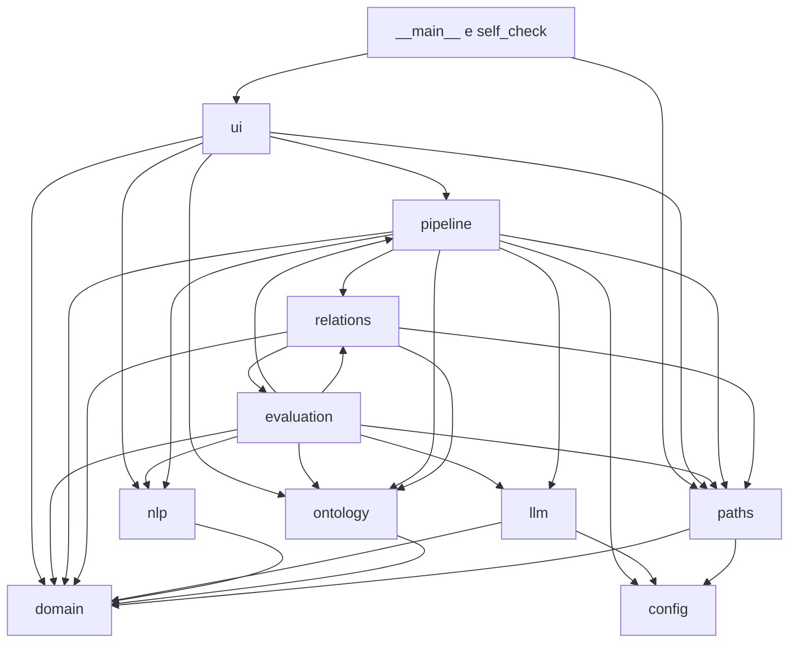
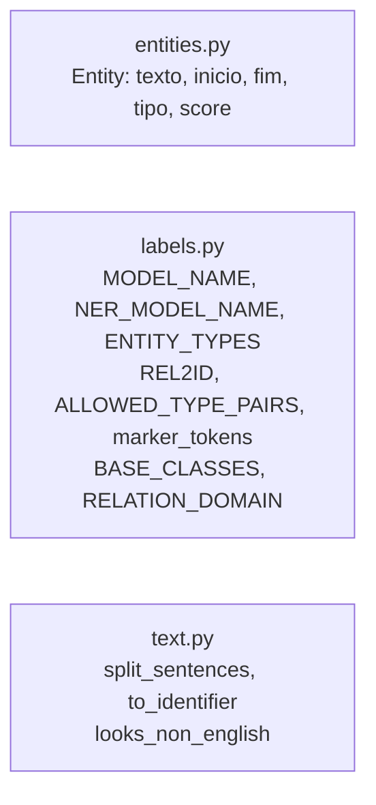
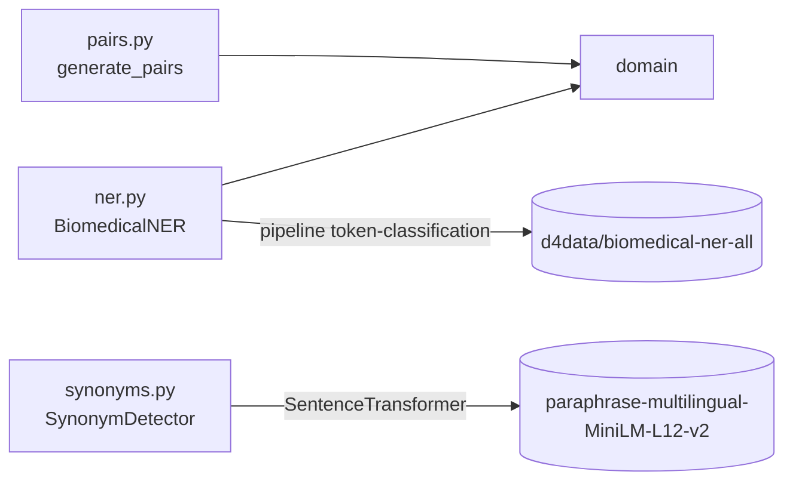
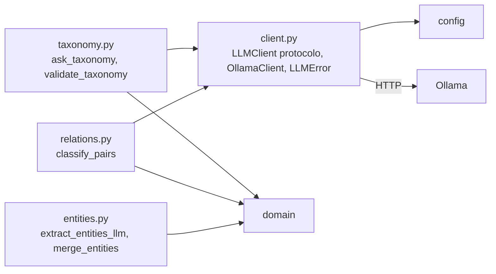
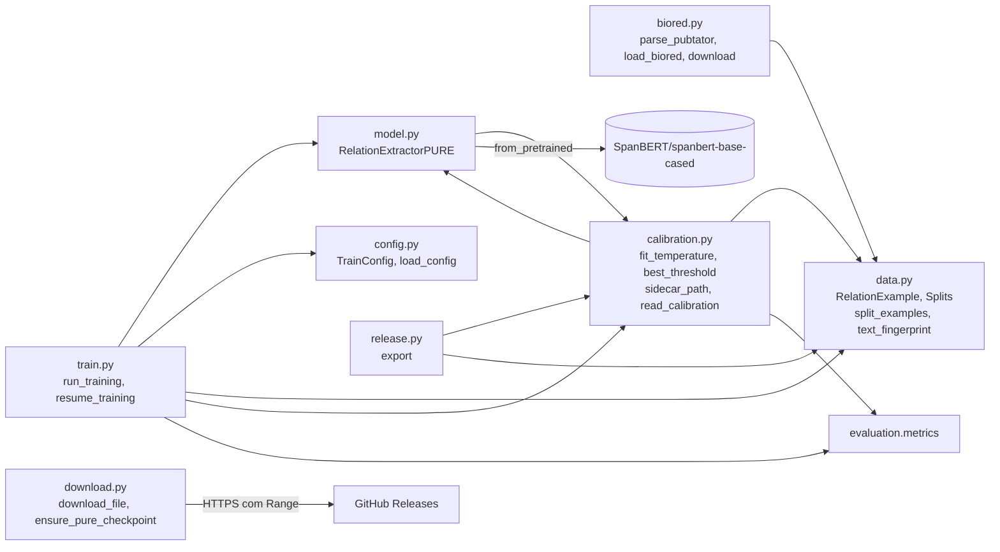
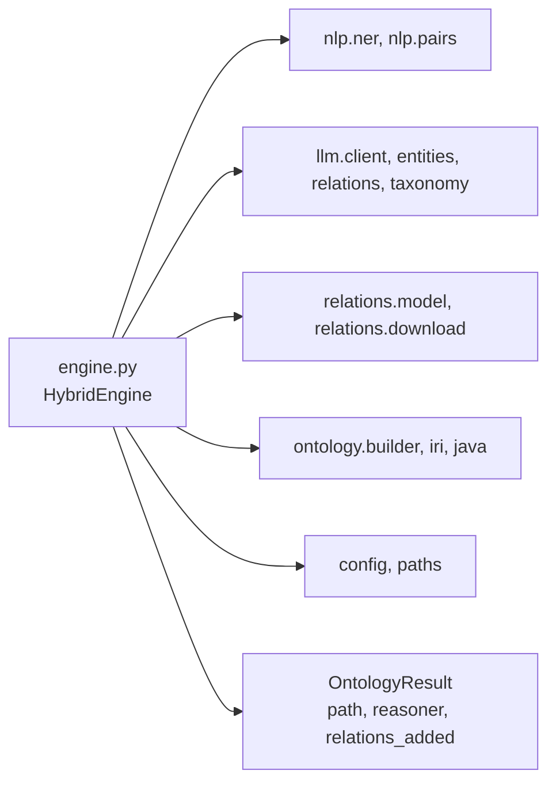
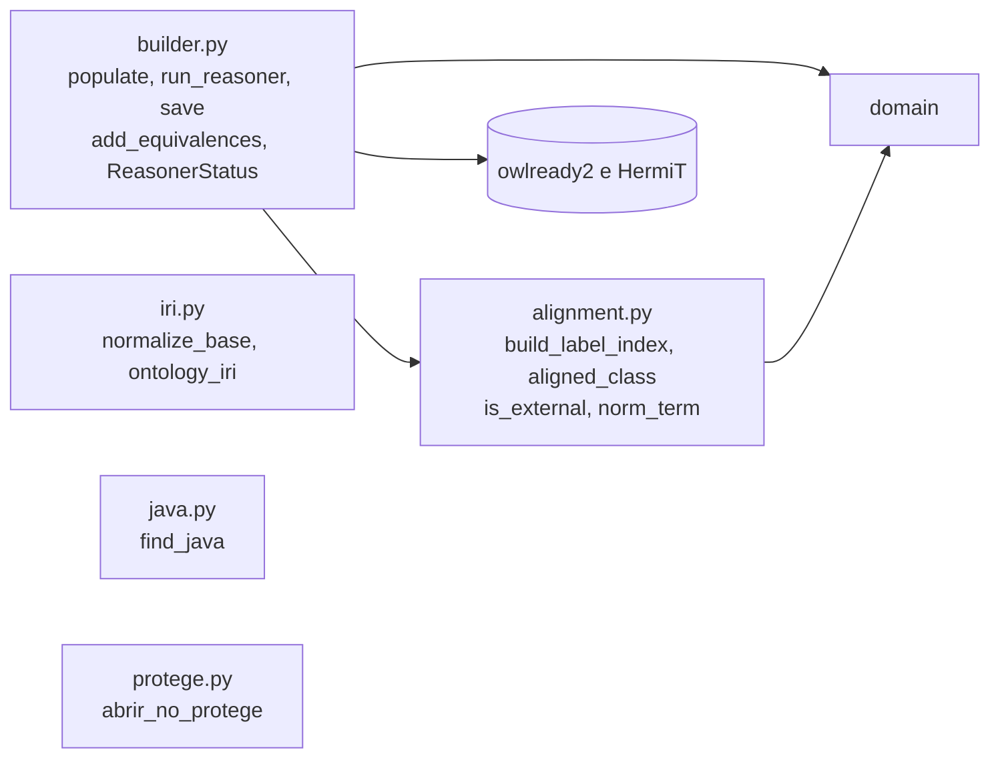
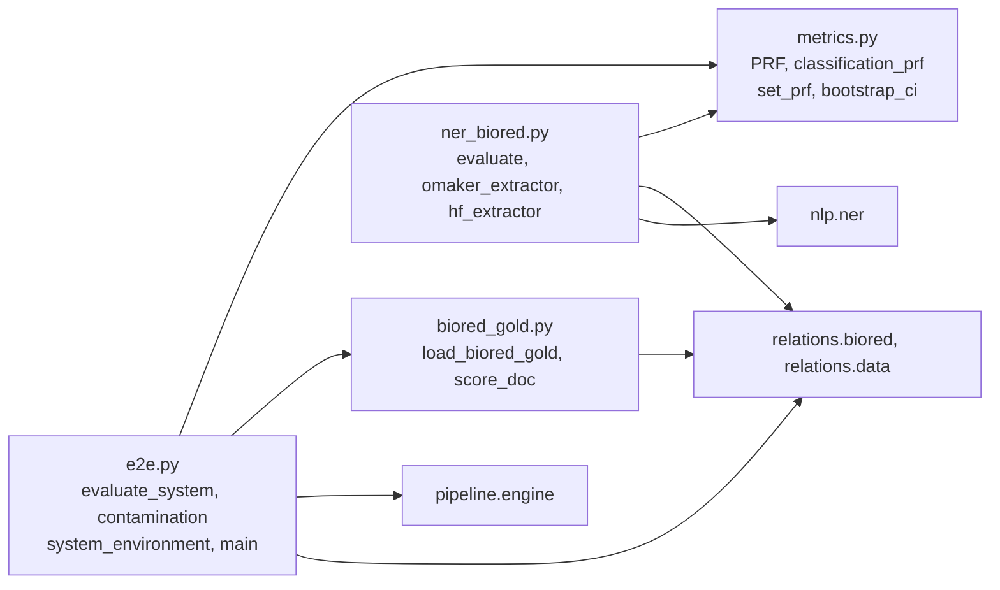
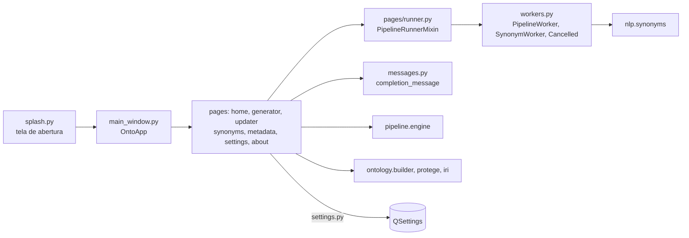

# 5. Visão de blocos

A decomposição é apresentada em dois níveis: primeiro os contêineres (o que roda e onde ficam os dados), depois os componentes de cada pacote de `omaker/`. As dependências entre pacotes foram conferidas nos `import` do código.

## 5.1 Nível 1: diagrama de contêineres

| Contêiner | Responsabilidade | Tecnologia | Onde |
|---|---|---|---|
| Aplicativo desktop | Páginas, coleta de entrada, execução em segundo plano, cancelamento, mensagens | PySide6 | `omaker/__main__.py`, `omaker/ui/` |
| Ferramentas de linha de comando | Treino, calibração, publicação e download do checkpoint, conversão do BioRED, avaliações | `argparse`, PyTorch | `omaker/relations/*.py`, `omaker/evaluation/*.py` (funções `main`) |
| Motor | Liga as etapas: entidades, pares, relações, taxonomia, OWL, raciocinador | Python puro, sem Qt | `omaker/pipeline/engine.py` |
| Componentes | NER, pares, sinônimos, cliente do LLM, PURE, montagem OWL, alinhamento | transformers, sentence-transformers, scikit-learn, owlready2, requests | `omaker/nlp/`, `omaker/llm/`, `omaker/relations/`, `omaker/ontology/` |
| Modelos locais | Pesos baixados e checkpoint do PURE com a calibração ao lado | Cache do Hugging Face; arquivos `.pt` e `.json` | [seção 7](07-visao-de-implantacao.md) |
| Armazenamento local | Ontologias, preferências e artefatos de experimentos | RDF/XML, registro do Windows, JSON, TOML | [seção 7](07-visao-de-implantacao.md) |
| Ollama | Respostas do LLM em JSON validado por esquema | Serviço HTTP local | externo |
| Java e HermiT | Consistência lógica e inferências | JVM; jars do HermiT vêm no owlready2 | externo |

## 5.2 Nível 2: dependências entre pacotes

`domain` e `config` não dependem de nada do projeto. A seta `relations --> evaluation` fecha um ciclo entre pacotes: o treino e a calibração usam as métricas (`omaker/evaluation/metrics.py`), e a avaliação usa os leitores de dados (`omaker/relations/data.py`, `omaker/relations/biored.py`). Não há ciclo entre módulos, mas o ciclo entre pacotes está registrado como débito ([seção 11](11-riscos-e-debito-tecnico.md)). A dependência `relations --> ontology` é só de `norm_term` (`omaker/ontology/alignment.py`, que não importa o owlready2).

| Pacote | Responsabilidade | Depende de (projeto) | Bibliotecas externas |
|---|---|---|---|
| `domain` | Tipos e constantes compartilhados; utilidades de texto | nenhum | nenhuma |
| `config`, `paths` | Variáveis de ambiente lidas na hora; caminhos independentes da pasta corrente | `config`; `domain` | nenhuma |
| `nlp` | NER, pares candidatos, agrupamento de sinônimos | `domain` | transformers, sentence-transformers, scikit-learn, numpy |
| `llm` | Cliente do Ollama e as três tarefas do LLM | `config`, `domain` | requests |
| `relations` | Modelo PURE, dados, treino, calibração, publicação, download, leitor do BioRED | `domain`, `paths`, `evaluation`, `ontology` | torch, transformers, requests |
| `pipeline` | Orquestração do texto até o `.owl` | `config`, `domain`, `llm`, `nlp`, `ontology`, `paths`, `relations` | nenhuma diretamente |
| `ontology` | Montagem OWL, alinhamento, IRI, Java, Protégé | `domain` | owlready2 |
| `evaluation` | Métricas, avaliação de ponta a ponta, gabarito do BioRED, medida do NER | `domain`, `llm`, `nlp`, `ontology`, `paths`, `pipeline`, `relations` | torch, transformers |
| `ui` | Janela, páginas, threads de trabalho, mensagens | `domain`, `nlp`, `ontology`, `paths`, `pipeline` | PySide6 |

## 5.3 Nível 3: componentes por pacote

### domain

Três módulos independentes entre si. `labels.py` é a fonte única dos rótulos (a ordem de `REL2ID` define os ids das classes do PURE), dos 16 marcadores tipados, dos pares de tipos que valem a pena classificar, do limite de confiança padrão (0,70) e do nome do checkpoint. `text.py` divide frases sem quebrar em abreviações e tem a heurística de idioma.

### nlp

| Componente | Responsabilidade |
|---|---|
| `BiomedicalNER` | Roda o NER frase a frase (limite de 512 tokens), mapeia os rótulos para `DRUG`, `SYMPTOM` e `DISEASE`, descarta pontuação abaixo de 0,5, estende o trecho até a palavra inteira e remove sobreposições. Guarda as rejeições em `last_rejected` para o log. |
| `generate_pairs` | Gera amostras para o PURE: pares ordenados de entidades da mesma frase cujos tipos estão em `ALLOWED_TYPE_PAIRS`, com posições relativas à frase. |
| `SynonymDetector` | Vetoriza os termos com Sentence-BERT e agrupa por agrupamento aglomerativo com distância de cosseno (limite 0,25). Não depende de nenhum outro pacote. |

### llm

| Componente | Responsabilidade |
|---|---|
| `OllamaClient` | Confere o nome exato do modelo (`check`), pede JSON pelo esquema, tenta de novo com o erro de análise como retorno (duas novas tentativas), remove blocos de raciocínio e cercas de código, e falha na hora se a resposta bater no teto de tokens. |
| `extract_entities_llm` | Pede entidades por blocos de frases inteiras e localiza cada proposta no texto; o que não é achado é descartado. Pontuação fixa de 0,75. |
| `merge_entities` | União das listas do NER e do LLM; na sobreposição vence o trecho mais longo, depois a maior pontuação. |
| `classify_pairs` | Classifica pares pelo LLM, 15 por pedido, quando não há checkpoint. As relações voltam sem confiança. |
| `ask_taxonomy`, `validate_taxonomy` | Pede subclasses, tipo de cada indivíduo e grupos disjuntos; a validação descarta o que for incoerente ([seção 8](08-conceitos-transversais.md)). |

### relations

| Componente | Responsabilidade |
|---|---|
| `RelationExtractorPURE` | Insere os marcadores tipados, codifica com o SpanBERT, concatena o estado do marcador de abertura do sujeito com o do objeto e classifica com uma cabeça de duas camadas. `predict` aplica a temperatura; `load` confere os rótulos e lê o sidecar de calibração. Um par cujo marcador foi truncado vira `no_relation` com confiança 0. |
| `TrainConfig`, `run_training`, `resume_training` | Treino reproduzível por TOML; artefatos em `runs/<data>-<nome>/`; escolha da época pela validação; teste uma vez; `--install` copia o checkpoint para o caminho da interface. |
| `data.py` | Exemplos, divisão agrupada por frase e estratificada, gravação e leitura da divisão, hash das frases. |
| `biored.py` | Converte o BioRED para o esquema do OMAKER e baixa o zip de forma retomável. |
| `calibration.py` | ECE, temperatura por log-verossimilhança (LBFGS), limite pelo micro-F1 na validação, sidecar `*.calibration.json`. |
| `release.py` | Prepara os arquivos da Release: checkpoint sem o texto de treino, calibração e `SHA256SUMS`. |
| `download.py` | Baixa o checkpoint e a calibração publicados, com retomada e sha256. |

### pipeline

| Método | Responsabilidade |
|---|---|
| `extrair` | Texto para (taxonomia, triplas). Escolhe a fonte das entidades, gera pares, garante o checkpoint (baixa se faltar), classifica com o PURE ou com o LLM, aplica o limite de confiança, fica com a tripla de maior confiança por (sujeito, relação, objeto) e aplica o domínio das relações. Com `with_taxonomy=False` não chama o LLM para a taxonomia. |
| `construir` | Taxonomia e triplas para um `.owl`: IRI, `populate`, raciocinador e gravação. |
| `gerar_ontologia` | `extrair` seguido de `construir`. |
| `atualizar_ontologia` | `extrair`, carga da ontologia existente, `populate`, raciocinador e gravação no mesmo arquivo. |

### ontology

| Componente | Responsabilidade |
|---|---|
| `populate` | Cria ou reaproveita a raiz `BiomedicalEntity`, as classes-base, as subclasses (pais primeiro), as propriedades com domínio, os indivíduos com rótulo e os axiomas de relação; acrescenta disjunções sem repetir. Numa ontologia externa, alinha pelo índice de rótulos e cria o resto no namespace do OMAKER. |
| `run_reasoner` | Roda o HermiT com inferência de valores de propriedade e devolve `CONSISTENT`, `INCONSISTENT` ou `UNAVAILABLE`. |
| `add_equivalences` | Grava `owl:equivalentClass` entre as classes de cada grupo de sinônimos, numa cópia; sem equivalência nova, não grava arquivo. |
| `alignment.py` | Índice termo para classe (rótulos, sinônimos exatos, nomes), sem classes obsoletas nem as do próprio OMAKER; alinhamento restrito ao ramo do tipo. |
| `iri.py` | IRI absoluto e sem espaços; base inválida volta ao padrão `http://www.mestrado.edu/ontologias/`. |
| `java.py` | Localiza um `java.exe` mesmo fora do `PATH`. |
| `protege.py` | Abre o `.owl` no Protégé, com mensagem clara se o executável ou o arquivo faltar. |

### evaluation

| Componente | Responsabilidade |
|---|---|
| `metrics.py` | Micro-F1 sem `no_relation`, macro-F1, por classe, PRF de conjuntos e intervalo percentil por bootstrap. |
| `e2e.py` | Compara quatro sistemas (`llm`, `ner+llm`, `pure`, `both+pure`) mudando o ambiente durante a avaliação; casamento estrito e tolerante; armadilhas; contaminação; retomada por sistema e por documento. |
| `biored_gold.py` | Gabarito por conceito a partir do teste oficial do BioRED: acerto, falso positivo e ignorado. |
| `ner_biored.py` | Mede um NER contra as 1.671 menções do teste do BioRED, com casamento exato de início e fim. |

### ui

| Componente | Responsabilidade |
|---|---|
| `OntoApp` | Monta a barra lateral e as sete páginas; no fechamento durante uma execução, pede o cancelamento, recusa o fechamento e fecha sozinho quando a thread termina. |
| `PipelineRunnerMixin` | Comum ao Gerador e ao Atualizador: aviso de idioma, botão Cancelar, ligação dos sinais do worker a slots da thread da interface. |
| `PipelineWorker` | Roda uma função do motor numa `QThread`; emite exatamente um sinal final (`concluido`, `falhou` ou `cancelado`); o cancelamento vale na próxima mensagem de log. |
| `SynonymWorker` | Agrupa os sinônimos fora da thread da interface. A gravação das equivalências roda depois, na página, com confirmação. |
| `completion_message` | Texto final conforme `ReasonerStatus`: nunca diz "validado" quando o HermiT não rodou. |
| `SettingsPage` | Lê e grava as preferências no `QSettings` e as entrega às outras páginas por métodos de leitura (`modelo`, `temperatura`, `uri_base`, `pasta_exportacao`, `caminho_protege`). |
