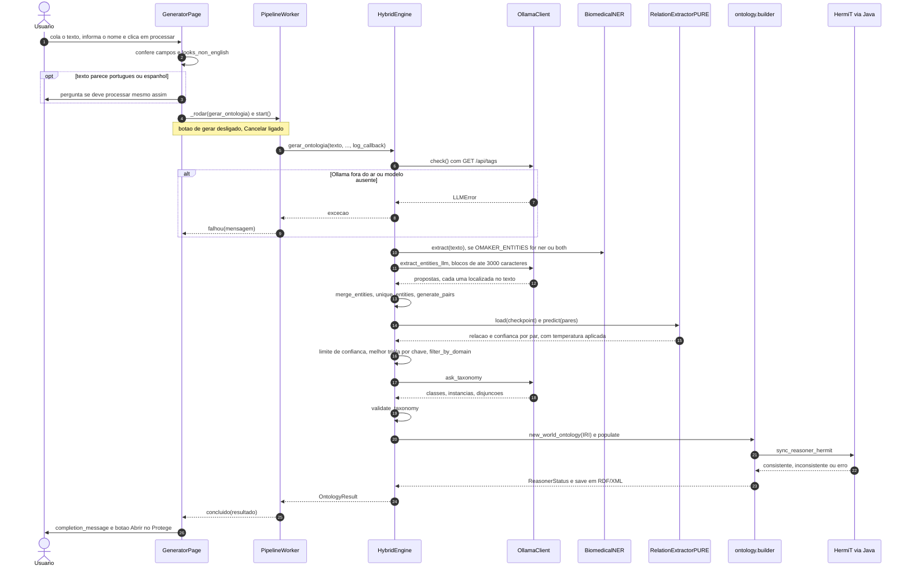
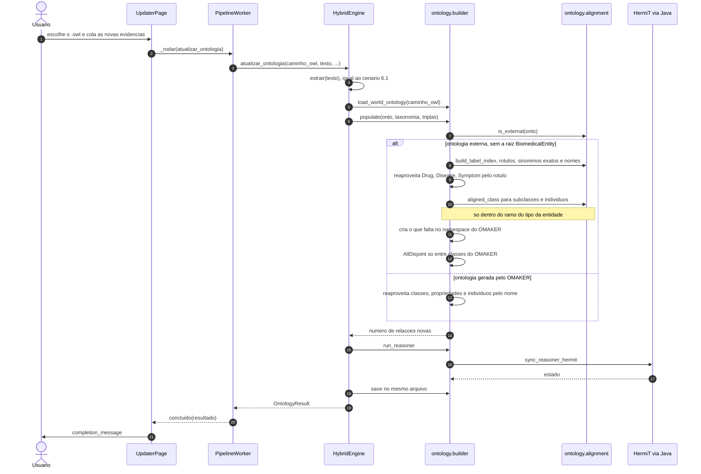
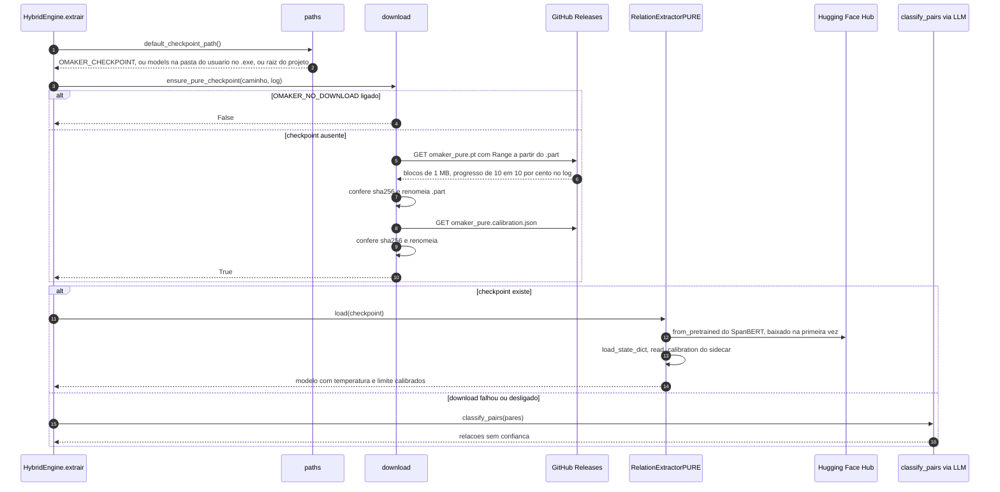
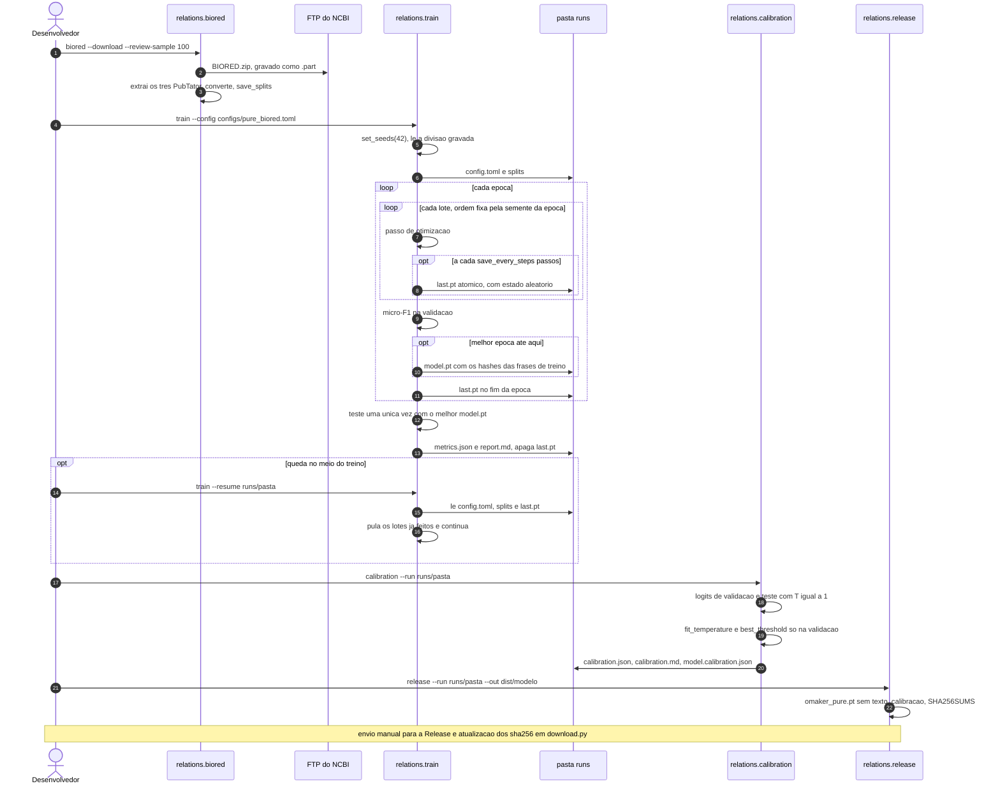
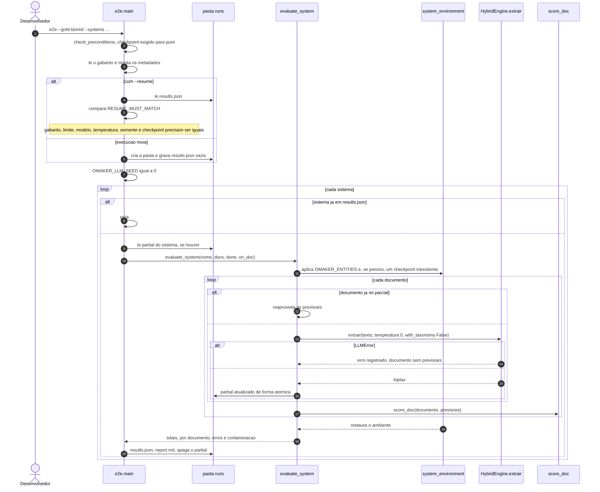

# 6. Visão de execução

Cinco cenários mostram como os blocos colaboram em tempo de execução. Os nomes nos diagramas são os das classes e funções do código, para que cada passo possa ser conferido.

## 6.1 Gerar uma ontologia: do texto ao OWL validado

Arquivos: `omaker/ui/pages/generator.py`, `omaker/ui/pages/runner.py`, `omaker/ui/workers.py`, `omaker/pipeline/engine.py`, `omaker/ontology/builder.py`.

Pontos de atenção:

- Cada etapa escreve no log pelo `log_callback`. No worker, esse callback emite o sinal `log` e, se o usuário pediu para cancelar, levanta `Cancelled` (subclasse de `BaseException`, para atravessar os `except Exception` do motor). O cancelamento vale, portanto, entre etapas, e uma chamada longa ao Ollama ou ao HermiT termina antes (`tests/test_pipeline_worker.py::test_cancel_not_swallowed_by_broad_except`).
- Se não houver pares candidatos, o PURE nem é carregado. Se não houver entidades, o motor levanta `ValueError` e a página mostra o erro.
- Sem checkpoint e sem download, as relações vêm de `classify_pairs` (LLM) e entram sem confiança ([cenário 6.3](#63-primeiro-uso-com-download-do-modelo)).
- O raciocinador nunca impede a gravação: uma ontologia inconsistente é salva e a mensagem final pede revisão.

## 6.2 Atualizar uma ontologia existente

Arquivos: `omaker/ui/pages/updater.py`, `omaker/pipeline/engine.py`, `omaker/ontology/builder.py`, `omaker/ontology/alignment.py`.

A atualização é idempotente: rodar duas vezes com a mesma entrada não duplica classes, indivíduos nem disjunções (`tests/test_alignment.py::test_second_update_is_idempotent`, `tests/test_alignment.py::test_alldisjoint_not_repeated_on_second_update`). O arquivo original é sobrescrito, sem cópia de segurança ([seção 11](11-riscos-e-debito-tecnico.md)).

## 6.3 Primeiro uso com download do modelo

Arquivos: `omaker/pipeline/engine.py`, `omaker/paths.py`, `omaker/relations/download.py`, `omaker/relations/model.py`, `omaker/relations/calibration.py`.

- O NER e o Sentence-BERT também vêm do Hugging Face na primeira vez que são usados, pelo cache padrão das bibliotecas.
- Uma queda no meio do download deixa o `.part`; a próxima execução continua de onde parou. Se o servidor ignorar o `Range` (resposta diferente de 206), o download recomeça do zero (`tests/test_download.py::test_download_resumes_after_a_drop`). Um sha256 diferente apaga o `.part` e falha (`tests/test_download.py::test_download_rejects_a_wrong_hash`).
- Qualquer falha de rede vira uma linha no log e o pipeline segue (`tests/test_download.py::test_ensure_reports_failure_without_raising`, `tests/test_hybrid_engine.py::test_missing_checkpoint_is_downloaded_before_falling_back_to_the_llm`).
- `uv run python -m omaker.relations.download` baixa o modelo antes, mesmo com o download automático desligado.

## 6.4 Treino e calibração do classificador

Arquivos: `omaker/relations/biored.py`, `omaker/relations/train.py`, `omaker/relations/calibration.py`, `omaker/relations/release.py`; configuração em `configs/pure_biored.toml`.

- A retomada reproduz o treino sem queda: mesmas métricas e mesma melhor época (`tests/test_training.py::test_resume_after_crash_matches_uninterrupted_run`, com quedas no meio da primeira época, no meio da segunda e no fim de uma época).
- `train --install` copia o melhor checkpoint para o caminho da interface e leva a calibração do mesmo treino, ou apaga uma calibração antiga (`tests/test_training.py::test_install_removes_a_stale_calibration`). `calibration --install` só copia se o checkpoint instalado tiver o mesmo sha256 (`tests/test_calibration.py::test_install_copies_calibration_only_to_the_same_model`).
- Resultado de referência: micro-F1 de teste 0,739 (IC 95% de 0,694 a 0,785) em 385 exemplos; temperatura 4,33; ECE no teste de 0,271 para 0,055; limite 0,35.

## 6.5 Avaliação de ponta a ponta com retomada

Arquivos: `omaker/evaluation/e2e.py`, `omaker/evaluation/biored_gold.py`, `omaker/pipeline/engine.py`.

- `system_environment` força o sistema escolhido: `OMAKER_ENTITIES` para a fonte das entidades e, nos sistemas cujas relações vêm do LLM, um `OMAKER_CHECKPOINT` que não existe, para o motor não usar o PURE (`tests/test_e2e.py::test_system_environment_is_applied_and_restored`). O download automático continua possível nesse caminho; em teste, `OMAKER_NO_DOWNLOAD=1` o desliga (`tests/conftest.py`).
- Um documento em que o LLM falha não entra no parcial, então a retomada tenta de novo (`tests/test_e2e.py::test_llm_error_counts_as_no_prediction_and_is_recorded`, `tests/test_e2e.py::test_biored_run_resumes_per_document`).
- Mudou o modelo ou o checkpoint, a retomada é recusada (`tests/test_e2e.py::test_resume_refuses_a_different_model`).
- Resultado de referência no teste do BioRED (100 resumos, 164 pares químico e doença), F1 estrito: `pure` 0,13; `both+pure` 0,09; `ner+llm` 0,16; `llm` 0,19.
