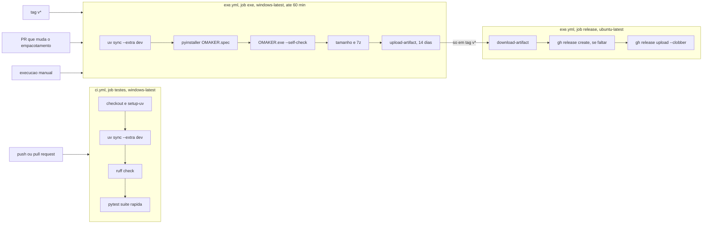

# 7. Visão de implantação

O OMAKER roda inteiro no computador do usuário. Não há servidor: os únicos serviços em rede são os de onde os modelos são baixados e o GitHub, onde o CI monta e publica o executável. Há dois cenários de implantação.

## 7.1 Cenários

| Cenário | Para quem | Como se instala | Como se executa |
|---|---|---|---|
| **A. Código-fonte com uv** | Desenvolvimento, treino e avaliação | `git clone`, depois `uv sync --extra dev` (o uv instala o Python 3.12 de `.python-version`) | `uv run python -m omaker` (ou `uv run python OMAKER.py`) a partir da raiz; ferramentas com `uv run python -m omaker.relations.train` e afins |
| **B. Executável leve** | Usuários, avaliadores, outros pesquisadores | Baixar `OMAKER-windows.zip` da Release da versão (por exemplo `v0.3.0`) e descompactar | `OMAKER\OMAKER.exe` |

Nos dois cenários, o Ollama (com o modelo do LLM), o Java e o Protégé são instalados à parte. O `.exe` traz só a interface e o motor; as ferramentas de linha de comando não são expostas nele. Ele tem 771 MB descompactado e 296 MB no `.zip`, e baixa os modelos na primeira execução ([registro 0008](../decisoes/0008-executavel-leve-com-download.md)).

## 7.2 Diagrama de implantação

```mermaid
flowchart TB
  subgraph pc["Computador do usuario, Windows"]
    subgraph srcA["Cenario A: clone do repositorio"]
      venv["Ambiente .venv do uv<br/>Python 3.12 e dependencias"]
      code["Pacote omaker na raiz"]
      ckA[("omaker_pure.pt e omaker_pure.calibration.json<br/>na raiz do repositorio")]
      runs[("runs/ e data/biored<br/>artefatos de treino e avaliacao")]
    end
    subgraph exeB["Cenario B: pasta OMAKER descompactada"]
      exe["OMAKER.exe<br/>PyInstaller, sem console"]
      internal["Bibliotecas, owlready2 com HermiT<br/>symp.owl, LICENSE"]
      ckB[("LOCALAPPDATA/OMAKER/models<br/>omaker_pure.pt e calibracao")]
    end
    hfcache[("Cache do Hugging Face<br/>NER, SpanBERT, Sentence-BERT")]
    reg[("QSettings no registro do usuario<br/>MeuMestrado/OntoGenApp")]
    owlfiles[("Pasta de destino dos .owl")]
    ollama["Ollama<br/>localhost:11434"]
    jvm["Java 11 ou mais novo<br/>PATH, JAVA_HOME ou JRE do Protege"]
    protege["Protege, opcional"]
  end
  subgraph net["Internet"]
    hf["Hugging Face Hub"]
    rel["GitHub Releases<br/>pure-biored-v1 e v0.3.0"]
    ncbi["FTP do NCBI, BioRED"]
  end
  code --> ckA
  code --> runs
  exe --> ckB
  code --> hfcache
  exe --> hfcache
  code --> reg
  exe --> reg
  hfcache -. "primeiro uso" .-> hf
  ckA -. "download se faltar" .-> rel
  ckB -. "download se faltar" .-> rel
  runs -. "biored --download" .-> ncbi
  code --> ollama
  exe --> ollama
  code --> jvm
  exe --> jvm
  code --> owlfiles
  exe --> owlfiles
  owlfiles --> protege
```

## 7.3 Onde ficam os arquivos

| Artefato | Cenário A (código-fonte) | Cenário B (`.exe`) | Definido em |
|---|---|---|---|
| Checkpoint do PURE | `omaker_pure.pt` na raiz do repositório | `%LOCALAPPDATA%\OMAKER\models\omaker_pure.pt` (a pasta do programa é temporária) | `default_checkpoint_path` em `omaker/paths.py`; `OMAKER_CHECKPOINT` substitui os dois (`tests/test_paths.py::test_frozen_app_keeps_the_checkpoint_in_the_user_folder`) |
| Sidecar de calibração | `omaker_pure.calibration.json` ao lado do checkpoint | idem | `sidecar_path` em `omaker/relations/calibration.py` |
| Download parcial | `<checkpoint>.part` ao lado do destino | idem | `partial_path` em `omaker/relations/download.py` |
| Modelos do Hugging Face | Cache padrão do `transformers` e do `sentence-transformers` na pasta do usuário | idem | O código não altera o cache; vale a configuração da biblioteca |
| Preferências da interface | `QSettings("MeuMestrado", "OntoGenApp")`, no registro do Windows do usuário | idem | `default_settings` em `omaker/ui/pages/settings.py` |
| Ontologias geradas | Pasta de destino escolhida nas Configurações; antes de escolher, a pasta corrente | idem | `SettingsPage.pasta_exportacao` |
| Cópia com sinônimos | `<nome>_sinonimos.owl` na pasta de destino | idem | `omaker/ui/pages/synonyms.py` |
| Recursos do pacote | `omaker/resources/symp.owl` e os outros dados de `omaker/` | Dentro da pasta do programa, pela lista `datas` do `OMAKER.spec` | `package_resource` em `omaker/paths.py` |
| Artefatos de treino e avaliação | `runs/<data>-<nome>/` e `data/biored/`, na raiz (fora do git) | Não se aplica | `_from_root` em `omaker/relations/train.py`; `.gitignore` |

`project_root()` devolve a raiz do repositório no cenário A e a pasta de recursos do PyInstaller (`sys._MEIPASS`) no cenário B. Por isso nenhum caminho depende da pasta de onde o programa foi aberto, com uma exceção: o valor inicial da pasta de destino ([seção 11](11-riscos-e-debito-tecnico.md)).

## 7.4 Pipeline de integração contínua

| Workflow | Gatilho | O que faz | Permissões |
|---|---|---|---|
| `.github/workflows/ci.yml` | Todo `push` e `pull_request` | Instala com `uv sync --extra dev`, roda `uv run ruff check .` e `uv run pytest -q -m "not slow and not ollama"` (224 testes, sem rede), com `QT_QPA_PLATFORM=offscreen` | `contents: read` |
| `.github/workflows/exe.yml`, job `exe` | `workflow_dispatch`, tag `v*` e PRs que mexem em `OMAKER.spec`, `OMAKER.py`, `omaker/__main__.py`, `omaker/self_check.py`, `pyproject.toml`, `uv.lock` ou no próprio workflow | Monta o `.exe` com o PyInstaller, roda `OMAKER.exe --self-check`, mostra o tamanho, compacta em `OMAKER-windows.zip` e guarda como artefato por 14 dias | `contents: read` |
| `.github/workflows/exe.yml`, job `release` | Só quando o ref é uma tag `v*`, depois do job `exe` | Baixa o artefato, cria a Release da tag se ela não existir e anexa o `.zip` | `contents: write`, só neste job |

Detalhes que sustentam a confiança no executável:

- **Autoverificação.** O `.exe` não tem console, então `--self-check` grava o resultado num arquivo. Ele importa todos os módulos que o pipeline usa (inclusive os que o `transformers` só carrega na hora), instancia BERT e DistilBERT mínimos sem baixar nada e confere `symp.owl`, `LICENSE` e a pasta do HermiT (`omaker/self_check.py`). Um módulo esquecido pelo PyInstaller falha no CI, e não na máquina do usuário. O mesmo código roda na suíte rápida a partir do código-fonte (`tests/test_self_check.py::test_self_check_passes_from_source`).
- **Actions fixadas pelo SHA.** `actions/checkout` (v4.4.0), `astral-sh/setup-uv` (v5.4.2), `actions/upload-artifact` (v4.6.2) e `actions/download-artifact` (v4.3.0) são referenciadas pelo SHA do commit, com a versão em comentário. Uma tag movida no repositório da action não muda o que roda.
- **Escrita mínima.** O padrão dos dois workflows é `contents: read`; só o job `release`, que roda num runner separado e não executa código do repositório, recebe `contents: write`.
- **Guardas de empacotamento na suíte rápida.** `tests/test_packaging.py` confere que o `.spec` é Python válido, lista todos os arquivos de dados do pacote, leva a `LICENSE` e que a versão de `omaker/__init__.py` bate com a do `pyproject.toml`.

A Release do modelo (`pure-biored-v1`) não é montada pelo CI: os arquivos são preparados com `python -m omaker.relations.release` e enviados à mão, e os sha256 publicados ficam fixos em `omaker/relations/download.py` (`tests/test_download.py::test_published_hashes_are_filled_in`).
