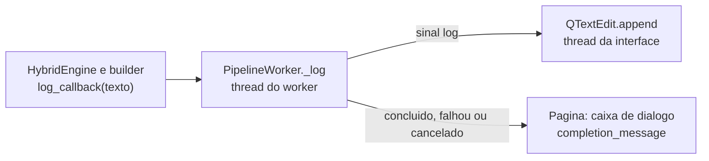

# 8. Conceitos transversais

Esta seção reúne as regras que valem para vários pacotes ao mesmo tempo: como o sistema lê a configuração, onde grava os arquivos, como sobrevive a quedas, como garante que um resultado possa ser refeito, como trata erros e o que faz com o texto do usuário. Cada regra aponta o código que a implementa e o teste que a confere.

## 8.1 Configuração

O OMAKER tem três fontes de configuração, cada uma com um público:

| Fonte | Para quem | Onde fica | Quando é lida |
|---|---|---|---|
| Variáveis de ambiente | Desenvolvimento, avaliação e ajustes finos | `omaker/config.py`, mais duas leituras diretas (tabela abaixo) | Na hora do uso, a cada chamada |
| Preferências da interface | Usuário da interface | `QSettings("MeuMestrado", "OntoGenApp")`, no registro do Windows (`default_settings` em `omaker/ui/pages/settings.py`) | Ao abrir a página de Configurações e a cada geração |
| Arquivo TOML de treino | Quem treina o classificador | `configs/pure_base.toml`, `configs/pure_biored.toml`, seção `[train]` (`omaker/relations/config.py`) | No início do treino; uma cópia vai para `runs/<pasta>/config.toml` |

### Variáveis de ambiente

As funções de `omaker/config.py` recebem o ambiente como parâmetro e, sem ele, leem `os.environ` no momento da chamada. Nada é lido na importação: mudar uma variável depois de importar o módulo tem efeito (`tests/test_config.py::test_env_change_after_import_is_seen`). A revisão de 2026-11-09 tinha achado o contrário: valores lidos uma vez, na importação, e espalhados pelo código.

| Variável | Valor padrão | Efeito | Lida em | Teste |
|---|---|---|---|---|
| `OLLAMA_HOST` | `http://localhost:11434` | Endereço do Ollama. Sem esquema, recebe `http://`. | `ollama_host` em `omaker/config.py`, chamada pelo `OllamaClient` | `tests/test_config.py::test_host_without_scheme_gets_http` |
| `OMAKER_ENTITIES` | `both` | Fonte das entidades: `ner`, `llm` ou `both`. Vazio vale `both`; outro valor gera `ValueError`. | `entity_source` em `omaker/config.py`, chamada só por `HybridEngine.extrair` | `tests/test_config.py::test_invalid_entity_source_raises`, `test_empty_entity_source_defaults_to_both` |
| `OMAKER_CHECKPOINT` | nenhum (ver 8.2) | Caminho do checkpoint do PURE. | `checkpoint` em `omaker/config.py`, usada por `default_checkpoint_path` | `tests/test_paths.py::test_checkpoint_env_override` |
| `OMAKER_LLM_SEED` | nenhum | Semente inteira enviada ao Ollama em `options.seed`. | `llm_seed` em `omaker/config.py`, chamada por `OllamaClient._options` | `tests/test_e2e.py::test_llm_seed_sent_to_ollama` |
| `OMAKER_JAVA` | nenhum | `java.exe` usado pelo HermiT; é o primeiro lugar consultado. | `find_java` em `omaker/ontology/java.py` | `tests/test_java_locator.py::test_omaker_java_wins` |
| `OMAKER_NO_DOWNLOAD` | desligado | Qualquer valor diferente de vazio e de `0` desliga o download automático do checkpoint. | `ensure_pure_checkpoint` em `omaker/relations/download.py` | `tests/test_download.py::test_ensure_skips_when_disabled_or_present` |

Duas regras de projeto aparecem aqui:

- **Validação perto do uso.** `OMAKER_ENTITIES` só é validada onde as entidades são extraídas. Um valor errado não quebra comandos que não usam a variável, como o treino ou o cliente do Ollama (`tests/test_config.py::test_bad_entity_source_does_not_break_checkpoint_or_client`), mas aparece ao gerar (`test_bad_entity_source_reported_when_generating`).
- **Leituras fora do módulo.** `OMAKER_JAVA` e `OMAKER_NO_DOWNLOAD` estão documentadas no cabeçalho de `omaker/config.py`, mas são lidas direto nos módulos que as usam. O sistema também lê `LOCALAPPDATA` (`omaker/paths.py`) e `JAVA_HOME` (`omaker/ontology/java.py`).

### Preferências da interface

A página de Configurações grava no `QSettings` as chaves `modelo`, `lista_modelos_disponiveis`, `temperatura` (inteiro de 0 a 100, dividido por 100 ao ler), `diretorio_exportacao`, `caminho_protege`, `autor` e `uri_base` (`salvar_configuracoes` em `omaker/ui/pages/settings.py`). As outras páginas não leem o `QSettings` diretamente: usam os leitores `modelo()`, `temperatura()`, `pasta_exportacao()`, `caminho_protege()` e `uri_base()` (`tests/test_ui_pages.py::test_settings_readers`). Ao gravar, a chave `api_key`, sobra da versão com Gemini, é apagada. Modelos `gemini*` gravados por versões antigas são descartados ao carregar (`tests/test_ui_pages.py::test_settings_drops_old_gemini_models`).

Nos testes, uma fixture automática troca o `QSettings` real por um `.ini` temporário (`isolated_qsettings` em `tests/conftest.py`).

### Configuração de treino

`load_config` recusa chaves desconhecidas na seção `[train]` (`tests/test_training.py::test_load_config_reads_toml_and_rejects_unknown_key`). Os valores padrão estão em `TrainConfig` (`omaker/relations/config.py`): semente 42, frações 0,7, 0,15 e 0,15, 15 épocas, ponto de retomada a cada 50 passos. A configuração do BioRED (`configs/pure_biored.toml`) usa 5 épocas e a divisão oficial gravada em `data/biored/splits`.

## 8.2 Caminhos independentes da pasta corrente

No `.exe`, a pasta corrente é imprevisível. Por isso nenhum caminho de dados do sistema é relativo a ela. O módulo `omaker/paths.py` concentra as regras:

| Função | Código-fonte | Executável (PyInstaller) |
|---|---|---|
| `project_root()` | Pasta que contém `OMAKER.py` | `sys._MEIPASS`, a pasta de recursos do executável |
| `package_resource(nome)` | `omaker/resources/<nome>` | O mesmo caminho dentro da pasta do executável |
| `user_data_dir()` | `%LOCALAPPDATA%\OMAKER`; fora do Windows, `~/.local/share/OMAKER` | Idem |
| `default_checkpoint_path()` | `OMAKER_CHECKPOINT`, se definida; senão `omaker_pure.pt` na raiz | `OMAKER_CHECKPOINT`, se definida; senão `%LOCALAPPDATA%\OMAKER\models\omaker_pure.pt` |

No executável, o checkpoint não fica na pasta do programa, porque ela é temporária e pode ser somente leitura; fica na pasta gravável do usuário (`tests/test_paths.py::test_frozen_app_keeps_the_checkpoint_in_the_user_folder`). O caminho padrão não muda com a pasta corrente (`tests/test_paths.py::test_checkpoint_path_independent_of_cwd`), e a `symp.owl` padrão da página de Sinônimos vem de `package_resource` (`tests/test_ui_synonyms.py::test_synonyms_default_independent_of_cwd`).

As ferramentas de linha de comando seguem a mesma regra: os caminhos relativos de um TOML de treino são resolvidos a partir da raiz (`_from_root` em `omaker/relations/train.py`), e as pastas `runs/` e `data/biored` ficam na raiz (`omaker/evaluation/e2e.py`, `omaker/relations/biored.py`).

Há duas exceções conhecidas, descritas na [seção 11](11-riscos-e-debito-tecnico.md): a pasta de destino padrão das ontologias é a pasta corrente (`os.path.abspath(".")` em `carregar_configuracoes`, `omaker/ui/pages/settings.py`), e o caminho passado em `--config` é relativo à pasta corrente.

## 8.3 Retomada de tarefas longas

Treino, avaliação e downloads levam de minutos a horas. Cada um grava pontos de retomada, e toda gravação é atômica: o conteúdo vai para um arquivo temporário e só depois troca de nome (`Path.replace`). Uma queda no meio da gravação deixa intacto o ponto anterior.

| Tarefa | Ponto de retomada | Como retomar | O que é conferido | Testes |
|---|---|---|---|---|
| Treino do PURE (`omaker/relations/train.py`) | `runs/<pasta>/last.pt`, a cada `save_every_steps` passos (50 por padrão) e ao fim de cada época, gravado via `last.pt.part` | `python -m omaker.relations.train --resume runs/<pasta>` | Usa a `config.toml` e a divisão `splits/` gravadas na pasta; restaura modelo, otimizador, agendador, histórico, melhor época e o estado dos geradores aleatórios (Python, NumPy, PyTorch e CUDA) | `tests/test_training.py::test_resume_after_crash_matches_uninterrupted_run` (queda no meio da primeira época, no meio da segunda e no fim de uma época) |
| Avaliação de ponta a ponta (`omaker/evaluation/e2e.py`) | `results.json` gravado no início e depois de cada sistema; `partial-<sistema>.json` a cada documento (o `+` do nome vira `_`), gravado via arquivo `.part` | `python -m omaker.evaluation.e2e --resume runs/<pasta>` | Recusa retomar se mudou algum item de `RESUME_MUST_MATCH`: hash do gabarito, limite de documentos, modelo, temperatura, semente e hash do checkpoint | `tests/test_e2e.py::test_resume_skips_systems_already_evaluated`, `test_resume_refuses_a_different_model`, `test_biored_run_resumes_per_document` |
| Download do checkpoint (`omaker/relations/download.py`) | `<destino>.part` | Automático, na próxima execução ou com `python -m omaker.relations.download` | Pede o resto com o cabeçalho `Range: bytes=<feito>-`; se o servidor não responde 206, recomeça do zero; confere o sha256 antes de trocar o nome | `tests/test_download.py::test_download_resumes_after_a_drop`, `test_download_rejects_a_wrong_hash` |
| Download do BioRED (`omaker/relations/biored.py`) | `BIORED.zip.part`, apagado se o download falha | `python -m omaker.relations.biored --download` | Pula o que já existe; um `.zip` corrompido é apagado; sem `Range`, um download interrompido recomeça do zero | `tests/test_biored.py::test_download_interrupted_leaves_no_zip_and_retries`, `test_download_reuses_existing_zip` |

Detalhes que tornam a retomada do treino exata:

- A ordem dos lotes é fixa por época: o `DataLoader` usa um gerador com semente `seed * 1000 + época`. Ao retomar no meio da época, os mesmos lotes são refeitos e os já usados são pulados.
- Um treino terminado (com `metrics.json`) não é retomado (`tests/test_training.py::test_resume_of_finished_run_does_nothing`), e um treino que caiu antes do primeiro ponto falha com uma mensagem clara (`test_resume_without_checkpoint_fails_clearly`).
- Ao terminar, `last.pt` é apagado, porque ocupa o tamanho do modelo inteiro.
- Limite: retomar na GPU um treino começado na CPU funciona, mas não reproduz bit a bit um treino feito só na GPU, porque o estado aleatório da GPU não existia no ponto gravado (`.conhecimento/06-experimentos/2026-11-12-pure-biored.md`).

Na avaliação, um documento em que o LLM falha conta como sem previsões, mas não entra no parcial: a retomada tenta de novo (`_predict` em `omaker/evaluation/e2e.py`; `tests/test_e2e.py::test_llm_error_counts_as_no_prediction_and_is_recorded`).

## 8.4 Reprodutibilidade

Os números da dissertação precisam poder ser refeitos. As medidas abaixo valem para o treino, a calibração e a avaliação; a interface não as aplica (ver o fim desta seção).

| Medida | Como | Onde | Teste |
|---|---|---|---|
| Sementes | `set_seeds` fixa Python, NumPy, PyTorch e CUDA antes da divisão e antes de criar o modelo; semente 42 por padrão | `omaker/relations/train.py` | `tests/test_training.py::test_training_is_reproducible` |
| Divisão fixa | Agrupada por texto (a mesma frase nunca cai em dois conjuntos) e estratificada pela relação quando cada relação tem ao menos três grupos | `split_examples` em `omaker/relations/data.py` | `tests/test_relation_data.py::test_split_is_deterministic_and_disjoint_by_text` |
| Manifesto e hash | O manifesto guarda semente, frações, sha256 do arquivo de origem, se houve estratificação e as contagens; a divisão vai para `runs/<pasta>/splits/` e pode ser relida com `splits_dir` em vez de sorteada de novo | `omaker/relations/data.py`, `omaker/relations/train.py` | `tests/test_training.py::test_existing_splits_are_reused`, `tests/test_relation_data.py::test_save_and_load_roundtrip` |
| Teste uma única vez | A época é escolhida pela validação; o teste roda uma vez, no fim, com o checkpoint da melhor época | `_train` em `omaker/relations/train.py` | `tests/test_training.py::test_test_set_evaluated_once` |
| Intervalo de confiança | Bootstrap percentil com 1000 reamostragens e semente fixa | `bootstrap_ci` em `omaker/evaluation/metrics.py` | `tests/test_metrics.py::test_bootstrap_ci_contains_point_and_is_reproducible` |
| Calibração só na validação | Temperatura e limite ajustados na validação; o teste só entra no relatório | `calibrate` em `omaker/relations/calibration.py` | Sem teste automatizado de `calibrate`; as peças têm testes em `tests/test_calibration.py` |
| LLM determinístico na avaliação | Temperatura 0 (`EVAL_TEMPERATURE`) e `OMAKER_LLM_SEED` definida com `--seed` (padrão 0) durante a avaliação, e restaurada depois | `omaker/evaluation/e2e.py`, `OllamaClient._options` em `omaker/llm/client.py` | `tests/test_e2e.py::test_llm_seed_sent_to_ollama` |
| Metadados de cada execução | Treino: `config.toml`, `splits/`, `metrics.json` e `report.md` com o commit e o comando exato. Avaliação: commit, hash do gabarito, modelo, temperatura, semente e hash do checkpoint em `results.json` | `omaker/relations/train.py`, `omaker/evaluation/e2e.py` | `tests/test_training.py::test_run_writes_artifacts`, `tests/test_e2e.py::test_results_written_after_each_system_with_metadata` |

O que não está coberto:

- O determinismo dos algoritmos da GPU (`torch.use_deterministic_algorithms`) não é configurado.
- Na interface, a temperatura vem das Configurações (0,1 por padrão; a extração de entidades pelo LLM usa no máximo 0,1, em `HybridEngine.extrair`) e não há semente, a menos que `OMAKER_LLM_SEED` esteja definida. Duas gerações com o mesmo texto podem dar taxonomias diferentes.

## 8.5 Tratamento de erros

### Erros do LLM

Toda falha do cliente do Ollama vira `LLMError`, uma subclasse de `RuntimeError` (`omaker/llm/client.py`). As mensagens dizem o que fazer:

| Situação | Comportamento | Teste |
|---|---|---|
| Ollama fora do ar | `LLMError` com "Install/start it (`ollama serve`)" | Sem teste automatizado |
| Modelo não instalado | `OllamaClient.check` exige o nome exato que o Ollama usa (sem tag, `:latest`) e lista os modelos instalados, com o comando `ollama pull` | `tests/test_llm_client.py::test_check_missing_model_suggests_pull`, `test_check_lists_installed_models`, `test_check_requires_the_exact_name_ollama_will_use` |
| JSON inválido | Até três tentativas (`retries=2`); cada nova tentativa leva o erro de leitura como mensagem ao modelo | `tests/test_llm_client.py::test_retries_with_parse_error_feedback`, `test_raises_after_retries` |
| Resposta no limite de tokens | Falha rápida: `done_reason == "length"` gera `LLMError` na hora, sem nova tentativa, porque com temperatura 0 e semente fixa o laço se repetiria | `tests/test_llm_client.py::test_output_limit_stops_a_looping_model_without_retrying` |
| Ollama antigo ou modelo sem o modo de raciocínio | Um erro 400 que cita `think` faz o cliente repetir o pedido sem esse campo | Sem teste automatizado |

O teto da resposta é `max_tokens = 4096` (`num_predict`), com contexto de 8192 tokens e tempo limite de 600 s por chamada ([registro 0013](../decisoes/0013-limite-de-tokens-do-llm.md)).

### Quedas controladas

Quando um componente falta ou falha, o sistema segue com um substituto menos bom e diz isso no log. Ele não esconde a troca e não afirma um resultado que não obteve.

| Falha | O que o sistema faz | Onde | Teste |
|---|---|---|---|
| LLM falha ao propor entidades, no modo `both` | Segue só com as entidades do NER; log "[LLM-NER] skipped" | `HybridEngine.extrair` em `omaker/pipeline/engine.py` | `tests/test_hybrid_engine.py::test_llm_entity_loop_falls_back_to_ner_entities` |
| LLM falha ao propor entidades, no modo `llm` | O erro sobe: não há outra fonte | Idem | `tests/test_hybrid_engine.py::test_llm_entity_loop_is_an_error_when_the_llm_is_the_only_source` |
| Checkpoint do PURE ausente | Tenta baixar; se continuar ausente, as relações são classificadas pelo LLM, sem confiança | `HybridEngine.extrair`; `classify_pairs` em `omaker/llm/relations.py` | `tests/test_hybrid_engine.py::test_missing_checkpoint_is_downloaded_before_falling_back_to_the_llm` |
| Download falha (sem internet, Release fora do ar) | Registra o motivo e devolve `False`, sem exceção; a retomada fica para a próxima vez | `ensure_pure_checkpoint` em `omaker/relations/download.py` | `tests/test_download.py::test_ensure_reports_failure_without_raising` |
| Sem arquivo de calibração | Temperatura 1 e limite fixo de 0,70 (`DEFAULT_CONFIDENCE_THRESHOLD`) | `RelationExtractorPURE.load`; `HybridEngine._relations_pure` | `tests/test_hybrid_engine.py::test_pure_uses_the_calibrated_threshold` |
| Java ausente ou HermiT com erro | A ontologia é gravada com `ReasonerStatus.UNAVAILABLE`, e a mensagem final diz que não houve validação | `run_reasoner` em `omaker/ontology/builder.py`; `omaker/ui/messages.py` | `tests/test_owl_builder.py::test_run_reasoner_unavailable_without_java`, `tests/test_ui_messages.py::test_completion_message_never_claims_validation_when_unavailable` |
| Ontologia inconsistente | Gravada com `ReasonerStatus.INCONSISTENT` e aviso de revisão | Idem | `tests/test_owl_builder.py::test_run_reasoner_inconsistent` |
| Resposta da taxonomia incoerente | Classe com nome de entidade, pai inexistente, ciclo ou ramo errado: a entidade volta à classe-base do seu tipo | `validate_taxonomy` em `omaker/llm/taxonomy.py` | `tests/test_hybrid_engine.py::test_taxonomy_validation_rejects_bad_llm_output` |
| Relação contra o domínio | Uma tripla `treats` ou `prevents` cujo sujeito não é um fármaco é descartada, com log "[SKIP]" | `filter_by_domain` em `omaker/pipeline/engine.py` | Sem teste automatizado próprio |

Há também falhas que param a operação de propósito, antes do trabalho lento: nenhuma entidade no texto (`ValueError` "No biomedical entities"), checkpoint com rótulos diferentes de `omaker/domain/labels.py` (`tests/test_relation_extractor.py::test_load_rejects_incompatible_labels`) e sistemas com PURE na avaliação sem checkpoint (`tests/test_e2e.py::test_preconditions_checked_before_running_any_system`).

### Erros na interface

`PipelineWorker` (`omaker/ui/workers.py`) roda o motor numa `QThread` e emite exatamente um sinal final: `concluido`, `falhou` (com a mensagem da exceção) ou `cancelado`. A página mostra a falha no log e numa caixa de diálogo (`_ao_falhar` em `omaker/ui/pages/runner.py`). O cancelamento é cooperativo: a exceção `Cancelled` é levantada na próxima mensagem de log. Ela herda de `BaseException` para atravessar os `except Exception` do motor, como o de `run_reasoner` (`tests/test_pipeline_worker.py::test_cancel_not_swallowed_by_broad_except`).

### Exceções genéricas

O ruff roda com a regra `BLE` (`pyproject.toml`). Cada `except Exception` que sobra no código tem um `noqa: BLE001`, em geral com o motivo ao lado: os workers e o slot da página de Sinônimos, que transformam qualquer falha em sinal ou caixa de erro; o HermiT, que pode falhar de muitas formas; o download, que não pode derrubar o pipeline; a verificação de contaminação, que trata um checkpoint ilegível como não verificável; e o `--self-check`, que transforma cada falha numa linha do relatório. O download do BioRED captura `BaseException` só para apagar o `.part` e relança o erro.

## 8.6 Logs enviados à interface

O motor não conhece a interface. Todas as funções de `HybridEngine` e de `omaker/ontology/builder.py` recebem uma função de log (`log` ou `log_callback`) e escrevem nela linhas em inglês, com uma etiqueta da etapa: `[NER]`, `[LLM-NER]`, `[PAIRS]`, `[PURE]`, `[LLM]`, `[RELATIONS]`, `[SKIP]`, `[OWL]`, `[AXIOM]`, `[ALIGN]`, `[HERMIT]`, `[IRI]`, `[WARNING]` e `[SUCCESS]`.

- Na interface, `PipelineWorker._log` emite o sinal `log`, ligado ao `append` do campo de log da página. O slot roda na thread da interface, então nenhum widget é tocado pela thread do worker (`omaker/ui/pages/runner.py`; `tests/test_pipeline_worker.py::test_emits_log_and_result_from_other_thread`).
- A mesma chamada de log é o ponto de cancelamento (`tests/test_pipeline_worker.py::test_cancel_stops_at_next_log`).
- O resumo final, em português, vem de `completion_message` (`omaker/ui/messages.py`), que escolhe o texto pelo estado do raciocinador e nunca anuncia uma validação que não ocorreu.
- Nas ferramentas de linha de comando, a função de log é `print`. Na avaliação de ponta a ponta, o log do motor é descartado (`lambda _msg: None` em `default_extract`), e os avisos vão para a saída de erro.
- O OMAKER não usa o módulo `logging` nem grava arquivo de log: o log da interface existe só no campo da página.

## 8.7 Idioma

O pipeline é só em inglês: o NER `d4data/biomedical-ner-all`, o SpanBERT, os dados do BioRED e os prompts do LLM ([registro 0001](../decisoes/0001-pipeline-em-ingles.md)). A interface é em português.

- O campo de texto do Gerador pede "um texto em inglês" (`omaker/ui/pages/generator.py`; `tests/test_ui_generation.py::test_pages_say_the_text_must_be_in_english`).
- Antes de gerar ou atualizar, `looks_non_english` (`omaker/domain/text.py`) conta palavras muito comuns em português e espanhol. Com 12 palavras ou mais e ao menos 8% delas na lista, a página pergunta se deve processar mesmo assim (`_confirmar_idioma` em `omaker/ui/pages/runner.py`). Textos curtos nunca são marcados.
- Testes: `tests/test_text_utils.py::test_portuguese_and_spanish_texts_are_flagged`, `test_english_medical_text_is_not_flagged`, `test_short_text_is_never_flagged`; `tests/test_ui_generation.py::test_non_english_text_asks_before_generating`, `test_non_english_text_asks_before_updating`.
- O log do motor e os prompts ficam em inglês; as caixas de diálogo, em português.

## 8.8 Verificação das propostas do LLM no texto

O LLM é o componente menos confiável do pipeline. A regra transversal é: ele propõe, o código confere, e o que não passa na conferência não entra na ontologia.

| O que o LLM devolve | Como o código confere | Onde | Teste |
|---|---|---|---|
| Formato da resposta | Esquema JSON enviado ao Ollama (`format`); blocos `<think>` e cercas de código removidos antes da leitura | `chat_json` e `_parse_json` em `omaker/llm/client.py` | `tests/test_llm_client.py::test_parses_think_block_and_fenced_json` |
| Entidades | Cada nome proposto é procurado no texto como palavra inteira, sem diferenciar maiúsculas; o que não aparece é descartado. A menção guardada é a do texto, com a posição real | `extract_entities_llm` em `omaker/llm/entities.py` | `tests/test_hybrid_engine.py::test_llm_entities_are_verified_in_text` |
| Tipos das entidades | Só `DRUG`, `SYMPTOM` e `DISEASE` (enumeração no esquema e conferência no código) | Idem | Idem |
| Sobreposição com o NER | Vence o trecho mais longo e, no empate, a maior pontuação; as entidades do LLM têm pontuação fixa de 0,75 | `merge_entities` em `omaker/llm/entities.py` | `tests/test_hybrid_engine.py::test_merge_both_sources` |
| Taxonomia | Classes-base não podem ser redefinidas; pai desconhecido vira a raiz; ciclos são quebrados; uma instância só aceita a classe proposta se ela descender da classe-base do seu tipo; disjunções entre ancestral e descendente são descartadas | `validate_taxonomy` em `omaker/llm/taxonomy.py` | `tests/test_hybrid_engine.py::test_taxonomy_validation_rejects_bad_llm_output` |
| Relações (sem checkpoint) | Só rótulos do esquema e índices de pares que existem; o resto fica `no_relation`. As relações ficam sem confiança (marcadas "LLM" no log) | `classify_pairs` em `omaker/llm/relations.py` | `tests/test_hybrid_engine.py::test_taxonomy_validation_rejects_bad_llm_output` (a resposta de teste inclui um índice fora do intervalo) |

O LLM também não decide quais pares existem: os pares candidatos vêm das entidades da mesma frase, filtrados pelos tipos permitidos (`ALLOWED_TYPE_PAIRS` em `omaker/domain/labels.py`; `generate_pairs` em `omaker/nlp/pairs.py`).

## 8.9 Segurança e privacidade

| Tema | Regra | Onde |
|---|---|---|
| Texto do usuário | O texto vai só para o Ollama em `OLLAMA_HOST`, que por padrão é a própria máquina. O NER, o PURE e o Sentence-BERT rodam localmente. Se o usuário apontar `OLLAMA_HOST` para outra máquina, o texto vai para lá | `omaker/llm/client.py`, `omaker/config.py` |
| Uso da rede | O código faz requisições HTTP em três módulos: o cliente do Ollama, o download do checkpoint (GitHub Releases) e o download do BioRED (servidor do NCBI, só na linha de comando). Os modelos do Hugging Face são baixados pelas próprias bibliotecas no primeiro uso | `omaker/llm/client.py`, `omaker/relations/download.py`, `omaker/relations/biored.py` |
| Sem chave de API | O motor não recebe chave, e a página de Configurações não tem campo para ela | `tests/test_hybrid_engine.py::test_engine_entry_points_take_no_api_key`, `tests/test_ui_pages.py::test_settings_has_no_api_key_field` |
| Checkpoint publicado sem texto | O checkpoint guarda só o sha256 de cada frase de treino normalizada (`text_fingerprint`), o bastante para a verificação de contaminação; a exportação para a Release remove o campo `train_texts` de checkpoints antigos | `omaker/relations/release.py`, `omaker/relations/data.py`; `tests/test_download.py::test_export_strips_training_texts`; [registro 0009](../decisoes/0009-checkpoint-publicado-sem-texto.md) |
| Integridade do download | O sha256 do checkpoint e da calibração está fixo no código e é conferido antes de o arquivo ser usado; um arquivo que não confere é apagado | `PURE_MODEL` em `omaker/relations/download.py`; `tests/test_download.py::test_published_hashes_are_filled_in` |
| Arquivos compactados | Do `.zip` do BioRED, só os três arquivos PubTator são extraídos, pelo nome, nunca pelo caminho guardado no `.zip` | `_extract` em `omaker/relations/biored.py` |
| Processos externos | O Protégé é aberto com uma lista de argumentos, sem shell; um caminho com espaços vai como um argumento só | `omaker/ontology/protege.py`; `tests/test_protege.py::test_path_with_spaces_passed_as_one_argument` |
| CI | Actions fixadas pelo SHA do commit; permissão `contents: read` por padrão e `contents: write` só no job que anexa o `.zip` à Release | `.github/workflows/ci.yml`, `.github/workflows/exe.yml` |
| Arquivos grandes no git | O pre-commit recusa arquivos acima de 2048 KB | `.pre-commit-config.yaml` |

Um ponto em aberto, descrito na [seção 11](11-riscos-e-debito-tecnico.md): `RelationExtractorPURE.load` chama `torch.load` sem `weights_only=True` explícito.

## 8.10 Testes e qualidade de código

| Prática | Como | Onde |
|---|---|---|
| Suíte de testes | 226 testes com `pytest` e `pytest-qt`, na pasta `tests/` | `pyproject.toml`, `[tool.pytest.ini_options]` |
| Suíte rápida | `pytest -q -m "not slow and not ollama"`: sem rede e sem modelos reais. Os dois testes `slow` (`tests/test_relation_extractor.py::test_spanbert_roundtrip` e `tests/test_training.py::test_real_spanbert_one_epoch`) baixam o SpanBERT do Hugging Face; o marcador `ollama` está declarado, mas nenhum teste o usa hoje | `.github/workflows/ci.yml`, `.pre-commit-config.yaml` |
| Dublês em vez de serviços | Um servidor HTTP local imita o Ollama (`fake_ollama`), um NER de mentira devolve entidades fixas (`stub_ner`), e uma fixture automática liga `OMAKER_NO_DOWNLOAD=1` para nenhum teste baixar o checkpoint | `tests/conftest.py` |
| Interface sem tela | `QT_QPA_PLATFORM=offscreen` no CI | `.github/workflows/ci.yml` |
| Lint | ruff com as regras E, F, W, B, I, UP e BLE, linha de 120, E501 desligada | `pyproject.toml` |
| CI | Em todo push e pull request, no Windows: `uv sync --extra dev`, `ruff check .` e a suíte rápida | `.github/workflows/ci.yml` |
| Executável | Montado e conferido com `--self-check` numa tag `v*`, em execução manual e em PRs que mexem no empacotamento | `.github/workflows/exe.yml`, `omaker/self_check.py`; `tests/test_self_check.py::test_self_check_passes_from_source` |
| Guardas de empacotamento | O `.spec` é Python válido, lista todos os dados do pacote, leva a `LICENSE`, e a versão bate com a do `pyproject.toml` | `tests/test_packaging.py` |
| Pre-commit | ruff com `--fix`, verificações de arquivo e a suíte rápida antes de cada commit | `.pre-commit-config.yaml` |

A regra de contribuição é que todo comportamento novo ou corrigido venha com teste (`CONTRIBUTING.md`). As correções da reestruturação seguiram o ciclo de escrever o teste que falha antes da correção (registros em `.conhecimento/09-planos/`).
