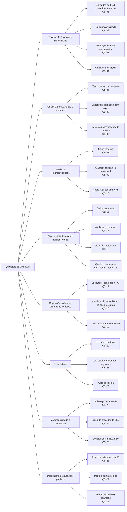

# 10. Requisitos de qualidade

Esta seção torna mensuráveis os cinco objetivos de qualidade da [seção 1.2](01-introducao-e-objetivos.md#12-objetivos-de-qualidade) e acrescenta os atributos que os sustentam (usabilidade, manutenibilidade, desempenho e qualidade preditiva). A árvore organiza os atributos; os cenários dizem, para cada um, o que acontece, como o sistema responde e como se mede.

Os requisitos não funcionais (`RNF-01` a `RNF-23`) estão em [../requisitos/nao-funcionais.md](../requisitos/nao-funcionais.md). Os cenários abaixo são a visão de arquitetura desses requisitos e de alguns requisitos funcionais que têm peso de qualidade (verificação do LLM, calibração). Cada cenário cita o código e o teste que o sustentam; a correspondência com os requisitos está na [seção 10.3](#103-cenários-e-requisitos-não-funcionais).

## 10.1 Árvore de qualidade

## 10.2 Cenários de qualidade

Cada cenário tem a forma: um estímulo chega, o sistema responde, e uma medida diz se a resposta foi a esperada. Quando a medida é um teste, ele roda na suíte rápida do CI, salvo indicação.

### Correção e honestidade

| Id | Atributo | Estímulo | Resposta | Medida |
|---|---|---|---|---|
| QS-01 | Correção | O LLM propõe uma entidade que não está escrita no texto | A proposta é descartada; só entram menções achadas no texto como palavra inteira, com a posição real (`omaker/llm/entities.py`) | Nenhuma entidade fora do texto: `tests/test_hybrid_engine.py::test_llm_entities_are_verified_in_text` |
| QS-02 | Correção | O LLM devolve uma taxonomia com classe com nome de entidade, pai inexistente, ciclo, instância no ramo errado e disjunção entre ancestral e descendente | Cada defeito é corrigido ou descartado; a entidade volta à classe-base do seu tipo (`omaker/llm/taxonomy.py`) | Todas as asserções de `tests/test_hybrid_engine.py::test_taxonomy_validation_rejects_bad_llm_output` |
| QS-03 | Honestidade | O HermiT não roda (sem Java) ou acha uma inconsistência | A ontologia é gravada, e a mensagem final diz "gerada sem validação" ou "inconsistente", nunca "validada" (`omaker/ui/messages.py`) | `tests/test_ui_messages.py::test_completion_message_never_claims_validation_when_unavailable`, `test_completion_message_inconsistent` |
| QS-04 | Correção | O PURE dá uma confiança alta a uma relação errada | A confiança é dividida pela temperatura calibrada, e o limite vem da validação (`omaker/relations/calibration.py`) | ECE no teste do BioRED de 0,271 para 0,055 com T = 4,33; limite 0,35 ([registro 0007](../decisoes/0007-calibracao-por-temperatura.md)); `tests/test_hybrid_engine.py::test_pure_uses_the_calibrated_threshold` |

### Privacidade e segurança

| Id | Atributo | Estímulo | Resposta | Medida |
|---|---|---|---|---|
| QS-05 | Privacidade | O usuário gera uma ontologia a partir de um texto clínico | O texto vai só para o Ollama em `OLLAMA_HOST` (por padrão, a própria máquina); NER, PURE e Sentence-BERT rodam localmente | Inspeção: só `omaker/llm/client.py`, `omaker/relations/download.py` e `omaker/relations/biored.py` fazem requisições HTTP, e só o primeiro envia o texto; nenhuma chave de API (`tests/test_hybrid_engine.py::test_engine_entry_points_take_no_api_key`) |
| QS-06 | Privacidade de terceiros | Um checkpoint é preparado para a Release pública | O arquivo leva só o sha256 das frases de treino, não o texto (`omaker/relations/release.py`) | `tests/test_download.py::test_export_strips_training_texts` |
| QS-07 | Segurança | O download do checkpoint chega corrompido ou adulterado | O sha256 não confere; o `.part` é apagado e o arquivo não é usado (`omaker/relations/download.py`) | `tests/test_download.py::test_download_rejects_a_wrong_hash` |

### Reprodutibilidade

| Id | Atributo | Estímulo | Resposta | Medida |
|---|---|---|---|---|
| QS-08 | Reprodutibilidade | Outra pessoa roda o mesmo treino com a mesma configuração | Mesma divisão (relida do manifesto) e mesmas sementes (`omaker/relations/train.py`, `omaker/relations/data.py`) | Métricas de teste e histórico iguais em duas execuções, com um modelo pequeno de teste na CPU: `tests/test_training.py::test_training_is_reproducible` |
| QS-09 | Reprodutibilidade e rastreabilidade | Alguém refaz a avaliação de ponta a ponta | LLM com temperatura 0 e semente fixa; `results.json` guarda commit, hash do gabarito, modelo, semente e hash do checkpoint (`omaker/evaluation/e2e.py`) | `tests/test_e2e.py::test_results_written_after_each_system_with_metadata`, `test_llm_seed_sent_to_ollama` |
| QS-10 | Validade científica | O treino termina | A época é escolhida pela validação, e o teste roda uma única vez | `tests/test_training.py::test_test_set_evaluated_once` |

### Robustez em tarefas longas

| Id | Atributo | Estímulo | Resposta | Medida |
|---|---|---|---|---|
| QS-11 | Recuperabilidade | O treino cai no meio de uma época | `--resume` continua do último `last.pt` (no máximo 50 passos perdidos) com o mesmo estado aleatório | Resultado igual ao de um treino sem queda, para quedas em três pontos diferentes: `tests/test_training.py::test_resume_after_crash_matches_uninterrupted_run` |
| QS-12 | Recuperabilidade | A avaliação cai no meio de um sistema (por exemplo, por falta de memória) | `--resume` aproveita os sistemas prontos e os documentos já gravados em `partial-<sistema>.json`; recusa retomar se o modelo, a semente, o gabarito ou o checkpoint mudaram | Perda máxima de um documento: `tests/test_e2e.py::test_biored_run_resumes_per_document`, `test_resume_refuses_a_different_model` |
| QS-13 | Recuperabilidade | A conexão cai durante o download de 438 MB | O `.part` fica; a próxima tentativa pede o resto com `Range` | `tests/test_download.py::test_download_resumes_after_a_drop` |
| QS-14 | Tolerância a falhas | O LLM entra em laço ao propor entidades, no modo `both` | A resposta para no teto de 4096 tokens com `LLMError`, sem nova tentativa; o pipeline segue com as entidades do NER | Sem espera de 600 s: `tests/test_llm_client.py::test_output_limit_stops_a_looping_model_without_retrying`, `tests/test_hybrid_engine.py::test_llm_entity_loop_falls_back_to_ner_entities` |
| QS-15 | Tolerância a falhas | Não há checkpoint do PURE e o download falha | O download registra o motivo sem lançar exceção; as relações são classificadas pelo LLM | `tests/test_download.py::test_ensure_reports_failure_without_raising`, `tests/test_hybrid_engine.py::test_missing_checkpoint_is_downloaded_before_falling_back_to_the_llm` |
| QS-16 | Tolerância a falhas | O LLM falha num documento da avaliação | O documento conta como sem previsões, o erro fica em `llm_errors` e a avaliação segue | `tests/test_e2e.py::test_llm_error_counts_as_no_prediction_and_is_recorded` |

### Instalação simples no Windows

| Id | Atributo | Estímulo | Resposta | Medida |
|---|---|---|---|---|
| QS-17 | Instalabilidade | Uma dependência nova não é coletada pelo PyInstaller | `OMAKER.exe --self-check` falha no CI, antes da Release (`omaker/self_check.py`, `.github/workflows/exe.yml`) | Falha detectada no CI, não no usuário: `tests/test_self_check.py::test_self_check_reports_a_missing_module`; tamanho do `.exe`: 771 MB descompactado, 296 MB no `.zip` |
| QS-18 | Portabilidade | O `.exe` é aberto de outra pasta, ou de um atalho | O checkpoint fica em `%LOCALAPPDATA%\OMAKER\models` e os recursos vêm da pasta do programa (`omaker/paths.py`) | `tests/test_paths.py::test_frozen_app_keeps_the_checkpoint_in_the_user_folder`, `test_checkpoint_path_independent_of_cwd` |
| QS-19 | Instalabilidade | O Java não está no `PATH`, mas existe em `C:\Program Files` ou no Protégé | `find_java` acha o Java e o HermiT roda (`omaker/ontology/java.py`) | `tests/test_java_locator.py::test_newest_jdk_in_roots`, `test_protege_bundled_jre` |

### Usabilidade

| Id | Atributo | Estímulo | Resposta | Medida |
|---|---|---|---|---|
| QS-20 | Responsividade | O usuário clica em Gerar; o pipeline leva minutos | O motor roda numa `QThread`; a janela continua respondendo e o botão fica desligado até o fim (`omaker/ui/workers.py`, `omaker/ui/pages/runner.py`) | `tests/test_ui_generation.py::test_generation_runs_off_gui_thread`, `test_generate_button_disabled_while_running` |
| QS-21 | Controle do usuário | O usuário cancela, ou fecha a janela durante uma geração | O cancelamento vale ao fim da etapa atual; a janela recusa fechar, pede o cancelamento e fecha sozinha quando a thread termina (`closeEvent` em `omaker/ui/main_window.py`) | `tests/test_ui_generation.py::test_cancel_generation`, `test_close_during_run_waits_for_worker`, `test_close_during_silent_step_does_not_block_and_closes_later` |
| QS-22 | Prevenção de erro | O usuário cola um texto em português | A página pergunta se deve processar mesmo assim, com "Não" como padrão (`_confirmar_idioma` em `omaker/ui/pages/runner.py`) | `tests/test_ui_generation.py::test_non_english_text_asks_before_generating` |

### Manutenibilidade e testabilidade

| Id | Atributo | Estímulo | Resposta | Medida |
|---|---|---|---|---|
| QS-23 | Testabilidade | Um contribuidor abre um pull request | O CI roda ruff e a suíte rápida no Windows, sem rede, com um Ollama falso em HTTP local e o download desligado (`.github/workflows/ci.yml`, `tests/conftest.py`) | 226 testes; a suíte rápida exclui só os 2 testes `slow` |
| QS-24 | Modificabilidade | Alguém quer usar outro provedor de LLM | Basta uma classe com `model` e `chat_json` (protocolo `LLMClient` em `omaker/llm/client.py`); o motor não muda | `tests/test_llm_protocol.py::test_engine_runs_with_any_llm_client` |
| QS-25 | Modificabilidade | Os rótulos de relação ou os tipos de entidade mudam | A mudança é feita só em `omaker/domain/labels.py`; um checkpoint antigo é recusado com uma mensagem clara | `tests/test_relation_extractor.py::test_load_rejects_incompatible_labels` |

### Desempenho e qualidade preditiva

| Id | Atributo | Estímulo | Resposta | Medida |
|---|---|---|---|---|
| QS-26 | Qualidade preditiva | O classificador é avaliado no teste do BioRED (385 exemplos) | Micro-F1 com intervalo de confiança de 95% por bootstrap (`omaker/evaluation/metrics.py`) | Micro-F1 0,739 (IC 95% 0,694 a 0,785); `causes` 0,795; `treats` 0,633. Sem meta fixada; o valor serve de linha de base |
| QS-27 | Qualidade preditiva | O pipeline inteiro é avaliado no teste do BioRED (100 resumos, 164 pares químico e doença) | F1 estrito por sistema, com os erros do LLM contados (`omaker/evaluation/e2e.py`, `omaker/evaluation/biored_gold.py`) | `pure` 0,13; `both+pure` 0,09; `ner+llm` 0,16; `llm` 0,19. NER sozinho: F1 0,409 nas 1.671 menções. Os riscos estão na [seção 11](11-riscos-e-debito-tecnico.md) |
| QS-28 | Eficiência | Primeiro uso do `.exe` sem o checkpoint; ou um treino do PURE com o BioRED | O checkpoint é baixado uma vez; o treino usa a GPU se houver | Download real de 438 MB em 22 s; treino com cerca de 2 min por época numa RTX 3050 de 6 GB, contra cerca de 8 s por passo na CPU (`.conhecimento/07-diario/2026-11-24.md`, `.conhecimento/06-experimentos/2026-11-12-pure-biored.md`). Medições pontuais, sem teste automatizado |

## 10.3 Cenários e requisitos não funcionais

| Cenário | Requisitos relacionados |
|---|---|
| QS-01, QS-02 | Requisitos funcionais de [extração de entidades](../requisitos/especificacoes/extracao-de-entidades/spec.md) e [geração de ontologia](../requisitos/especificacoes/geracao-de-ontologia/spec.md) |
| QS-03 | Requisitos funcionais de [geração de ontologia](../requisitos/especificacoes/geracao-de-ontologia/spec.md); RNF-13 |
| QS-04 | Requisitos funcionais de [modelo de relações](../requisitos/especificacoes/modelo-de-relacoes/spec.md) |
| QS-05 | RNF-01, RNF-02 |
| QS-06 | RNF-03 |
| QS-07 | RNF-20 |
| QS-08, QS-10 | RNF-04, RNF-06 |
| QS-09 | RNF-05 |
| QS-11, QS-12, QS-13 | RNF-10, RNF-11 |
| QS-14, QS-16 | RNF-12 |
| QS-15 | RNF-13 |
| QS-17 | RNF-07, RNF-15 |
| QS-18 | RNF-08 |
| QS-19 | RNF-07 |
| QS-20, QS-21 | RNF-14 |
| QS-22 | RNF-23 |
| QS-23 | RNF-17, RNF-18 |
| QS-24 | Requisitos funcionais de [integração com LLM](../requisitos/especificacoes/integracao-com-llm/spec.md) |
| QS-25 | RNF-19 |
| QS-26, QS-27 | Requisitos funcionais de [avaliação](../requisitos/especificacoes/avaliacao/spec.md) |
| QS-28 | RNF-15, RNF-16 |

Três requisitos não funcionais não têm cenário aqui, porque são verificados por inspeção ou pelo próprio CI: RNF-09 (caminhos com acento, `package = false` em `pyproject.toml`), RNF-21 (permissões mínimas dos fluxos do CI, [seção 8.9](08-conceitos-transversais.md#89-segurança-e-privacidade)) e RNF-22 (AGPL-3.0-only, `tests/test_packaging.py::test_license_ships_with_the_executable`).

## 10.4 O que os cenários não cobrem

- **Metas numéricas de qualidade preditiva.** QS-26 e QS-27 registram os valores atuais, sem um mínimo a cumprir. Não há teste que falhe se o F1 cair.
- **Tempo de resposta da interface.** Não há medida do tempo de uma geração; ele depende do Ollama, do modelo e do hardware.
- **Memória.** Não há limite verificado. Na avaliação, o Ollama com o `qwen3` ocupou cerca de 9,6 GB, e a execução foi interrompida três vezes por falta de memória ([seção 11](11-riscos-e-debito-tecnico.md)).
- **Determinismo na GPU.** QS-08 vale para a CPU; na GPU, `torch.use_deterministic_algorithms` não é configurado ([seção 8.4](08-conceitos-transversais.md#84-reprodutibilidade)).
